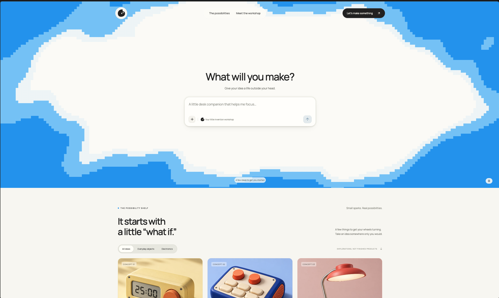
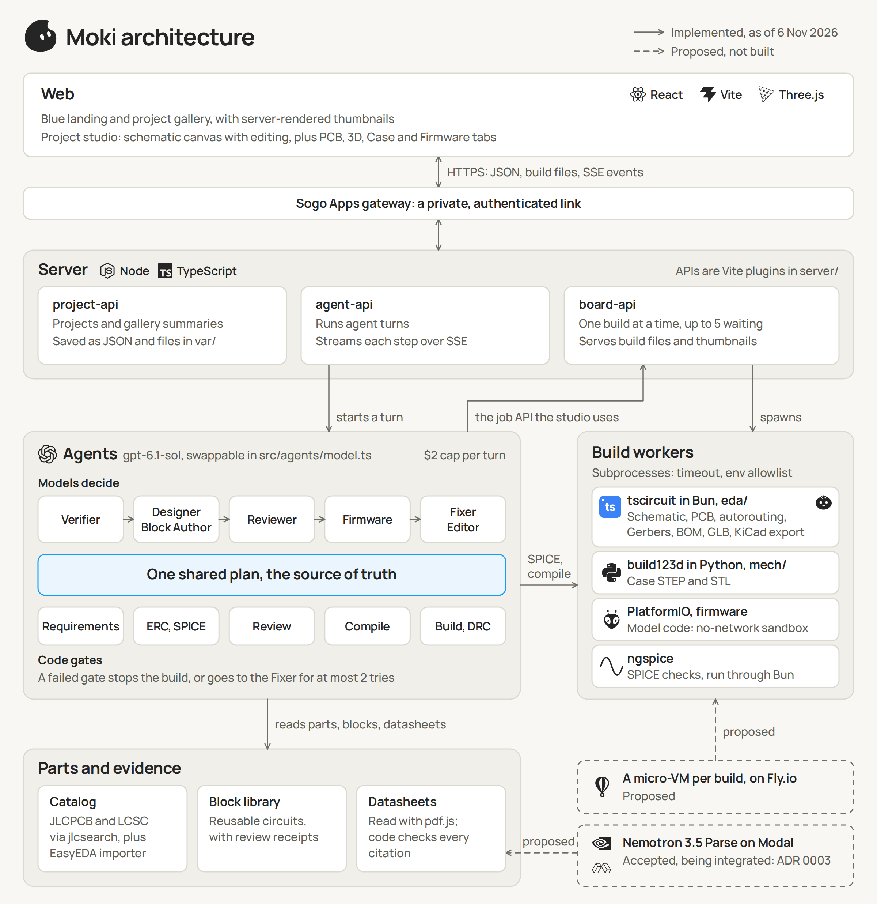

<div align="center">
  
  <h1>Moki</h1>
  <p>A little workshop for your next invention.</p>
  <p>
    <a href="#how-it-works">How it works</a> &nbsp;·&nbsp;
    <a href="#architecture">Architecture</a> &nbsp;·&nbsp;
    <a href="#run-locally">Run locally</a>
  </p>
</div>



Moki turns a description of a device into a schematic, a routed PCB, a printable case and compiled firmware. Code checks each of those files. Nothing Moki designed has been fabricated or powered yet, so a finished build is a checked design, not a proven device.

## How it works

1. **Describe the device.** The Verifier turns your words into requirements code can check and asks about anything vague. It also picks the route: a carrier board for kit modules, a chip-level board from real LCSC parts, or a board with no microcontroller.
2. **Confirm the requirements.** The Designer writes a plan: structured data listing kit modules or blocks, which are reusable chip-level circuits. If the library lacks a block, the Block Author finds a real part, reads its datasheet and writes one.
3. **The plan goes through gates.** Code runs ERC, the requirement checks and SPICE. On chip-level boards, a separate Reviewer checks the schematic against datasheets, and code confirms each quote appears on the cited page. The Firmware agent's code has to compile.
4. **Moki builds it.** The plan becomes a routed board, a case and a firmware project, and DRC runs on the result. When a gate fails, the Fixer gets at most 2 tries. After that the build stops and the chat names the gate.
5. **Inspect and change it.** Each project opens at `/studio/<id>`, with Schematic, PCB, 3D, Case and Firmware tabs. Edit on the canvas or in the chat. Either way the plan changes, the gates run again and the files are rebuilt. Download the Gerbers, BOM, pick-and-place, KiCad project, STEP, STL and firmware.

## Architecture



Models decide; code builds and checks. The agents share one plan instead of talking to each other, and the PCB, case and firmware are all regenerated from it. Code owns everything measurable, including board size, placement legality, prices and the gates, and each turn has a $2 budget cap. Every model call crosses one seam, `src/agents/model.ts`. OpenAI `gpt-6.1-sol` is the provider in use, and an Anthropic adapter and a replay adapter for tests sit at the same seam.

Agents build through the same job interface the studio uses, so a model can't do anything a maker's browser couldn't. One queue owns every build: one at a time, with up to 5 waiting. Workers are subprocesses with timeouts and an environment allowlist, which keeps model keys away from them, but this isn't a sandbox: generated board code runs on the host. Only model-written firmware compiles in a sandbox with no network, and it is never run. The dashed boxes aren't built yet.

[SVG](docs/diagrams/moki-architecture.svg) · [How the diagram is built, and the code behind each node](docs/diagrams/README.md)

| Part | Tools |
| --- | --- |
| Web | React 19, Vite 8, Three.js, Manrope |
| Server | Node 22, TypeScript, Vite-plugin APIs, SSE |
| Agents | OpenAI SDK, `gpt-6.1-sol` |
| Electronics | tscircuit 0.0.3075 in Bun 1.4: schematic, PCB, autorouting, Gerbers, BOM, GLB, KiCad export |
| Case | build123d 0.13 on Python 3.12: STEP and STL |
| Firmware | PlatformIO 6.1, compiled under bubblewrap |
| Simulation | ngspice, through `@tscircuit/ngspice-spice-engine` |
| Parts | JLCPCB and LCSC catalog via jlcsearch, EasyEDA importer |
| Datasheets | pdf.js, with citations checked by code |
| Saved work | JSON and generated files under `var/`, with no database |

## What works

**Kit boards build in about half a minute.** Each template ran 5 times cold and 3 times with its EDA cache, on an 8-core arm64 server with 16 GB. Every run produced a routed 2-layer board with 0 DRC errors, a case and compiled firmware.

| Template | Cold p50 | Cold p95 | Cached p50 |
| --- | --- | --- | --- |
| focus-timer | 31.2 s | 32.2 s | 19.0 s |
| light-lamp | 25.8 s | 27.4 s | 12.5 s |
| temp-monitor | 31.7 s | 34.0 s | 19.1 s |

**Agents handled all 11 briefs in the live kit bench as expected.** With `gpt-6.1-sol`, 6 built with 0 DRC errors and compiled firmware, and 5 were correctly declined as out of scope. The whole bench cost $0.103. A successful build cost $0.010 to $0.016 and took 9.8 to 12.2 s of agent time.

**Chip-level boards build when the plan is replayed.** Replays script the model calls and run everything else for real. A night light (20 × 42 mm) and a water-leak buzzer (28 × 56 mm) built with no firmware stage, and no-MCU boards take about 15 s. One exact RP2040 plan from a live run passes every gate, with 0 DRC errors and compiled firmware.

__TESTS__

## What isn't proven

- **No hardware.** Nothing has been fabricated, flashed or powered. Every check is a software check.
- **No live chip-level build.** 12 live runs cost $6.00 in total. A run that reached review cost $0.50 to $0.90 and took 4 to 11 minutes, and none has yet built a board end to end.
- **Dense routing.** This is the weak spot. An RP2040 with a DRV8833 takes 160 to 389 s, and some plans fail DRC or hit the 10-minute timeout.
- **Isolation.** Generated board code runs on the host, so per-build micro-VMs are needed before more than one person uses it.
- **Reviewed blocks.** A new block stays labelled unreviewed until an independent review promotes it.
- **Datasheet tables.** pdf.js flattens tables and can't see figures. Nemotron 3.5 Parse on Modal is being integrated. On 5 datasheets it read 81 of 81 pin-table rows and 48 of 50 electrical values, at about 6.7 s per page on an L4 GPU.

## Run locally

You need Node 22 or newer, [Bun](https://bun.sh), Python 3.12 with `venv`, and an OpenAI API key. Firmware also needs [PlatformIO](https://platformio.org) with `pio` on your `PATH`.

```sh
npm ci
(cd eda && bun install --frozen-lockfile)
python3 -m venv ~/.local/share/moki-tools/build123d-venv
~/.local/share/moki-tools/build123d-venv/bin/pip install -r mech/requirements.txt
cp .env.example .env   # then set OPENAI_API_KEY
npm run dev
```

Open http://127.0.0.1:5173/. Without a key the app still opens, with the agents off.

Compiling model-written firmware also needs `bwrap`, and `src/agents/pio-sandbox.sh` has its tool folder fixed in `TOOLS` on line 6, so change that for your machine.

| Variable | What it does |
| --- | --- |
| `OPENAI_API_KEY` | Turns the agents on. Keep it on the server. |
| `OPENAI_MODEL` | Defaults to `gpt-6.1-sol`. |
| `MOKI_AGENT_PROVIDER` | Set to `openai` if an Anthropic key is also in your environment. That key wins otherwise. |
| `MOKI_AGENTS=off`, `MOKI_CHIP=off` | Turn off the agents, or just chip-level boards. |
| `MOKI_BUN`, `MOKI_BUILD123D_PYTHON`, `MOKI_PLATFORMIO` | Point at tools installed somewhere else. |
| `MOKI_CHIP_TIMEOUT_MS` | Chip-level build limit, 10 minutes by default. |
| `MOKI_PROJECTS_DIR`, `MOKI_BOARD_JOBS_DIR` | Move saved projects and build jobs out of `var/`. |
| `MOKI_BASE_PATH`, `MOKI_PUBLIC_HOST`, `MOKI_BOARD_API_TOKEN` | For hosting. On a public host with no token, the agents stay off. |

Check your work with:

```sh
npm run typecheck
npm test
npm run build
```

`npm run preview` serves that build at http://127.0.0.1:8847/app/moki/.

Code from the earlier computer-use prototype is still in `server/workshop-api.ts`, `server/desktop-api.ts` and `scripts/`. Its routes exist only under `npm run dev`, and ADR 0001 explains why it was replaced.

## Decisions

- [ADR 0001: Code-first EDA instead of computer-use GUI agents](docs/adr/0001-code-first-eda-over-computer-use.md)
- [ADR 0002: Agent pipeline where models decide and code builds and checks](docs/adr/0002-agent-pipeline-models-decide-code-checks.md)
- [ADR 0003: Layout-aware datasheet parsing with Nemotron 3.5 Parse on Modal](docs/adr/0003-datasheet-layout-parsing-nemotron-parse.md) (accepted)
