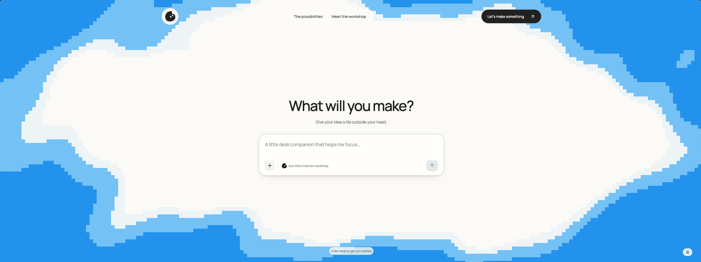
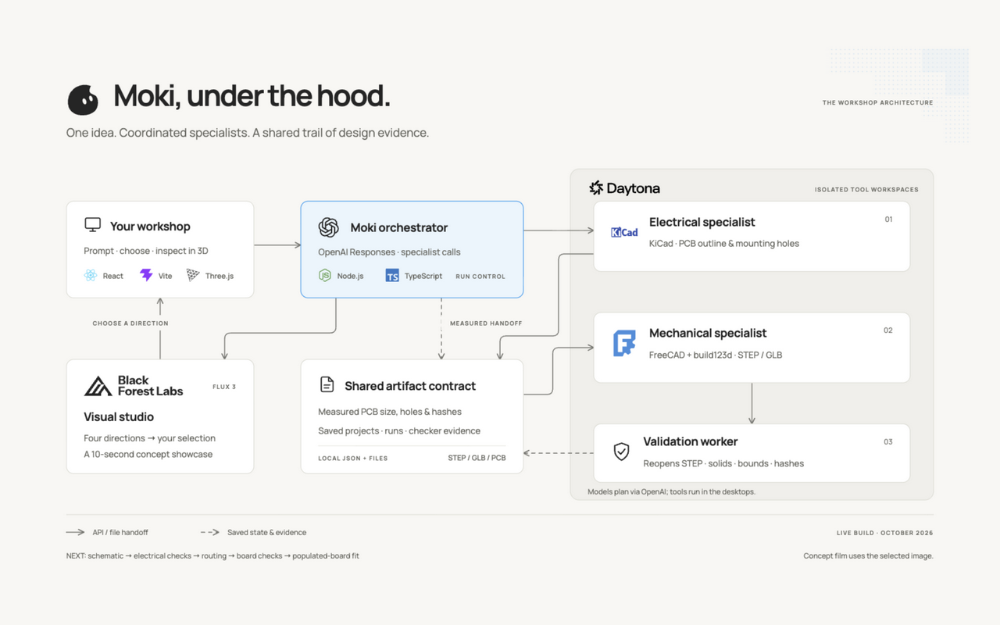

<div align="center">
  
  <h1>Moki</h1>
  <p>A little workshop for your next invention.</p>
  <p>
    <a href="#how-it-works">How it works</a> &nbsp;·&nbsp;
    <a href="#architecture">Architecture</a> &nbsp;·&nbsp;
    <a href="#run-locally">Run locally</a>
  </p>
</div>



Moki starts with a product idea. Describe what you want to make, choose a visual direction, and open a workshop where design agents work through a first CAD study. You can inspect the model in 3D, watch the engineering desktops, and return to the saved project later.

## How it works

1. Write a brief. Moki creates a new workshop and generates four visual directions with Black Forest Labs.
2. Choose a direction. The electrical specialist proposes a PCB outline and mounting holes in KiCad.
3. Build around measured geometry. The mechanical specialist receives the saved board's dimensions and file hash, then generates a first enclosure study with build123d.
4. Inspect the result. Moki exports STEP and GLB files, reopens the STEP for geometry checks, and shows the model in the browser. Electrical and mechanical stages also open live desktop views.
5. Give it a debut. BFL generates a ten-second concept film from the selected visual direction.

Project briefs, images, run events and generated files stay in the local `var/` directory. Reopening a workshop restores its saved work without starting another model job. The landing page lists saved and running projects.

## Architecture



The server coordinates specialist calls through OpenAI Responses. Daytona runs the engineering tools in two isolated Linux workspaces. Agents exchange saved files and measured geometry; the mechanical model records the PCB hash it used.

The validation worker reopens the exported STEP and checks its solids, dimensions and hashes. Results and stage events appear in the workshop as they arrive.

[Editable diagram](web/public/architecture/index.html) · [SVG](docs/diagrams/moki-architecture.svg) · [Diagram sources](docs/diagrams/README.md)

| Part | Tools |
| --- | --- |
| Web app | React, Vite, Three.js, Manrope and headless shadcn conversation components |
| Planning and coordination | TypeScript, Node.js and the official OpenAI SDK |
| Engineering desktops | Daytona SDK, KiCad 9, FreeCAD 1 and build123d |
| Images and concept film | Black Forest Labs FLUX |
| Saved work | Local JSON files, generated artifacts and content hashes |

The OpenAI Agents SDK manager/specialist scaffold is available separately. The live website currently uses server-coordinated Responses calls. [SDK decision](docs/sdk-decision.md)

## What works today

The current build produces visual directions, a proposed board outline, a first mechanical CAD study, geometry reports and a concept film. It saves real files and shows actual worker desktops.

Electronics still need a schematic, component selection, placement and routing, firmware, and electrical-rule checks. Real component clearances and assembly fit also remain unverified. A completed run is a design study; manufacturing release stays blocked. The film follows the selected image rather than the exported CAD geometry.

The next electrical workflow is schematic, electrical checks, PCB layout and routing, then board checks and populated-board fit. [Full workshop scope](docs/product/workshop.md)

## Run locally

You need Node.js 22 or newer, npm, an authenticated Daytona account, and OpenAI and BFL API keys.

```sh
npm ci
cp .env.example .env
# Configure server-side OpenAI and BFL keys, then authenticate Daytona.
daytona login
npm run dev
```

Open http://127.0.0.1:5173/. Set `OPENAI_API_KEY` and `BFL_API_KEY` in `.env`. Keep credentials on the server. The local adapters can reuse your authenticated Daytona CLI profile; `DAYTONA_API_KEY` is available for SDK access.

To provision or check the engineering desktops:

```sh
npm run doctor
npm run environments:setup -- --use-cli-profile
npm run environments:keep-running -- --use-cli-profile
npm run environments:status
npm run desktops:check -- --use-cli-profile
```

Each worker has 2 vCPUs and 4 GiB RAM. Idle stop, auto-pause, TTL and automatic deletion are disabled. A new design run opens fresh empty Moki documents while preserving previous project files. Workers stay running until explicitly stopped. [Environment details](docs/environments.md)

Keep `var/` if you want to keep your projects. Runs interrupted by a server restart are reported as interrupted. This build uses a local file store; a hosted database and deployment backend are still to come.

`npm run build` creates `dist/web`. `npm run preview` serves the static frontend on port 4173. Live workshops need the API bridge provided by `npm run dev`.

## Development

```sh
npm run typecheck
npm test
npm run build
```

`npm run openai:check` makes small paid API calls to check Responses and manager/validator delegation. `npm run infra:check -- --use-cli-profile` runs a fixed-geometry diagnostic separate from the website's prompt-driven pipeline. Neither check establishes circuit functionality.

## Further reading

- [Workshop behavior and limits](docs/product/workshop.md)
- [Coordination contracts](docs/architecture.md) and [SDK decision](docs/sdk-decision.md)
- [Engineering environments](docs/environments.md)
- [Character direction](docs/product/character.md) and [landing design](docs/product/landing.md)
- [CAD research](docs/research/cad-skills.md), [electrical research](docs/research/electrical-skills.md) and [3D previews](docs/research/threejs-preview.md)
- [Editable pipeline diagram](docs/pipeline/invention-platform.excalidraw)
