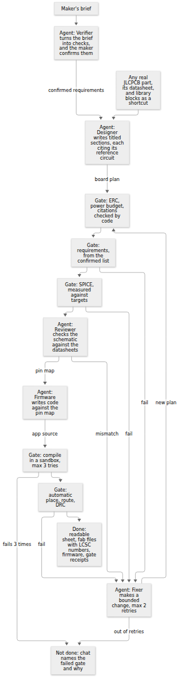

# Chip-level boards: architecture

**6 Nov update:** chip mode is wired into the live turn, but no live run has built a board yet. See `../2026-11-06-chip-live/reports/chip_live.md`. The rest of this page is as of 5 Nov.

**Status, 5 Nov 2026.** The Verifier and Firmware agent run live on carrier boards. The chip-level agents have run live on chip_eda's real blocks and datasheets, up to the point where a job would start, because the `{ plan }` job input isn't ready. No chip-level board has been built through them. Times marked estimated are estimates. The "mechanical requirements" section of the brief is on hold, and nothing here covers it.

Source: `architecture.mmd`. Label: **proposed**, because the chip-level path hasn't run end to end. The requirement gate also runs again after SPICE and on the final board size. After a fix the firmware is kept, because pins come from the plan. A schematic fix repeats ERC, requirements, SPICE and review. A build fix repeats ERC and the pin map, and review too if a pin or the layer count changed. Based on `src/agents/chip.ts`, `firmware.ts`, `datasheet.ts` and `src/blocks/contract.ts`.

## Principle

**The product is a correct, readable schematic.** Footprints, 3D models and routing come from tscircuit's sources, and layout stays automatic. Models decide what to build and return data or firmware source. They never draw copper. Code runs every gate.

## Modes

| | Carrier (today) | Chip-level (new) |
|---|---|---|
| For | Beginners, fast answers | Real products, assembled by JLCPCB |
| Unit | Catalog modules on a carrier board | Sections from any real JLCPCB part |
| Output | Board, case, firmware | Readable sheet, gerbers, BOM and CPL with LCSC numbers, firmware |
| Firmware | A fixed program, or the Firmware agent when none fits | Firmware agent |
| Asked for by | Default | Automatic since 6 Nov, when the kit can't do the brief. `MOKI_CHIP=off` turns it off |

## Contract

chip_eda owns and has agreed the types in `src/blocks/contract.ts`, which is the source of truth: `BlockDef`, `BlockDraft`, `Port`, `McuFacts`, `BoardPlan`, `GateResult`, `PinMap`, `CatalogPart`. It is plain JSON, and nothing assumes one MCU family: the MCU block names its family, PlatformIO target and pin capabilities.

A plan holds blocks, links, **sections** and **drafts**:

- **Section:** a title, a purpose, the blocks in it, design notes, and for an IC a reference to its datasheet: LCSC number, page, figure and an exact quote. Each becomes one titled box on the sheet, which chip_eda renders.
- **Draft:** a new block written as data, from any real part. chip_eda's code renders it to a subcircuit, so no model-written TSX runs on the server.

## Schematic pipeline

| Step | Who | What it checks | Fails to |
|---|---|---|---|
| Requirements | Verifier agent, then the maker | Plain checks from a fixed metric list, confirmed or edited in chat before design starts | The maker |
| Design | Designer agent | Follows each IC's application circuit, cites page and quote | Its own retry |
| ERC and power budget | chip_eda's code | Power sources, decoupling, pull-ups, straps, CC resistors, current budget, pin conflicts, required pins | Designer |
| Citations | Code | Each quote is really on that page of that part's datasheet | Designer |
| Requirement gate | chip_eda's engine | The confirmed list, after every change. A check it can't evaluate is shown as not checked, and the device isn't called done | Fixer, or reported with numbers |
| SPICE | chip_eda's code | Dividers, LED current, RC timing, charger current: measured against targets | Fixer |
| Review | Reviewer agent | The schematic against the datasheets, before layout | Fixer |
| Compile | Sandbox | The firmware compiles for that MCU | Firmware agent, 3 tries |
| Place, route, DRC | chip_eda's code | 0 DRC errors, automatic | Fixer |

Every failure names its gate in chat, and a device that can't pass is never shown as done. Passing means software checks passed. Nothing here proves a board works, and these gates can't catch noise, RF or thermal faults.

**Why code checks citations:** a model can invent a plausible page number. The Designer and Reviewer can only cite words that are really on the page, and a citation that fails goes back to them. A datasheet with no text layer can't be cited, so a section that needs it can't pass. On the real ESP32-S3-WROOM-1 datasheet, the extractor read 53 pages in 1.6 s and found the typical application circuit on page 41. A real quote passed, and the same quote on the wrong page or altered failed.

## Agent roles

| Agent | Input | Output | Limits |
|---|---|---|---|
| Verifier | The brief and the metric list, never the Designer's reasoning | Requirements, plus what it can't check | Only metrics and interfaces on the list. Only a maker's words can loosen one, and they confirm the new list |
| Designer | Brief, catalog, datasheets, library | Sectioned `BoardPlan`, or a decline | Declines only if no real part exists or mains voltage is involved |
| Reviewer | The plan and datasheets, not the Designer's reasoning | Findings per section: match, mismatch, cannot-verify or out-of-scope | Can't edit. Code decides the verdict. Mismatch and cannot-verify stop the build. Out-of-scope risks, like thermal or RF, are shown to the maker |
| Fixer | The failed gate | A corrected plan | Max 2 retries per stage. Never adds, removes or swaps a block or IC. After a schematic failure it may change passives and links. After a build failure it may change only placement, board size, layers and signal pins, because the circuit has already been reviewed |
| Firmware | Brief, `PinMap` | App source | Max 3 compiles, approved libraries only |
| Editor, Explainer | As today | As today | Carrier only for now. The Editor hands requirement changes to the Verifier |

The cap covers one chat turn across all its agents, and the effort picker sets it: Fast $0.50, Balanced and Deep $2 by default, never above the hard $2. Fast, Balanced and Deep map to a model, a reasoning level and a cap on the server (`MOKI_AGENT_EFFORTS`). Datasheet text is untrusted: it can't change an agent's rules.

## Growth loop

The seed list is a speed cache, not a limit. How a new part gets into the library:

1. **Find:** when no library block fits, the Designer searches the catalog. A part number has to come from a catalog response.
2. **Draft:** the Designer writes the block from the datasheet's application circuit, citing each value.
3. **Verify:** code runs ERC and the citation check, and chip_eda's `testBlock` runs it through a test board.
4. **Use, labelled:** it's usable at once and stays `unreviewed` in chat, UI and BOM.
5. **Review:** the Reviewer checks every board against the datasheets. **Promotion** also needs a review recorded against the block's `contentHash`, by a second agent or a person, so any edit returns it to unreviewed.
6. **Reuse:** a promoted block joins the library, so the next brief skips steps 1 to 5.

Steps 1, 2 and 4 are implemented on the agent side. The review record and promotion in steps 5 and 6 are not built. Promoted means reviewed, not proven on hardware. Today's second agent is the same model in a fresh context, so it shares that model's blind spots; a different model would be a stronger check.

**Open-ended, with limits:** any peripheral class is allowed. Mains voltage stays declined until a person decides otherwise (proposed; owner to confirm). RF should use pre-certified modules, because the gates can't check antenna matching.

**MCU families:** the ESP32 and S3 compile in the sandbox today. RP2040, STM32 and nRF52 each need an MCU block, an approved platform and a toolchain on this aarch64 server, none of which has been tried.

## Firmware safety

The Firmware agent's C++ is compiled on this server and never run here. The sandbox is the boundary:

- **Sandbox:** the compile runs in `bwrap` with no network, seeing only the project, its libraries and a read-only toolchain, so it can't see `moki.env` (`evidence/chip_agents/sandbox.json`). `moki.service` sets `NoNewPrivileges`, which blocks `bwrap`, so there the compile runs as its own user unit, limited to 130 s and 1.5 GB. If no sandbox starts, the compile fails.
- **Approved packages:** PlatformIO runs a package's install scripts outside the sandbox, so platforms and libraries come from a list in code that a person extends. A block can't add to it.
- **Source check:** includes must be literal names from the allowlist, with no assembly or file-reading tricks. This is a second defence that fails early. It isn't the boundary.
- **Same rules on every path:** the job API runs the check and sandbox too, and a job only counts if the firmware really compiled.

## Time and cost per build

Costs use `gpt-6.1-sol` at $2/$10 per million tokens. Measured rows are single runs of a simple board, so treat them as a floor.

| Step | Cost | Time | Basis |
|---|---|---|---|
| Verifier and confirm card | $0.004–0.012 | 7–13 s | Measured |
| Carrier design, fixed firmware | $0.014–0.016 | 40–51 s | Measured |
| Carrier design plus Firmware agent | $0.028–0.054 | 72–117 s | Measured |
| Carrier with Verifier and gate, all in | $0.019–0.038 | 18–80 s | Measured |
| Firmware change from chat | $0.026 | 66 s | Measured |
| One compile retry on a real error | $0.015 | 49 s | Measured, design step scripted |
| Compile alone | Free | 3–15 s | Measured |
| Chip-level, 5 library blocks, up to the job | $0.23 | 145 s | Measured: Verifier $0.012, Designer $0.087, Reviewer $0.112, Firmware $0.017. SPICE skipped, no job ran |
| Each new block drafted from a datasheet | $0.10–0.50 more | 2–5 min more | Estimated |
| Same block once promoted | $0 extra | 0 extra | By design, not measured |

On a focus timer, one run each: Fast $0.018 and 10.3 s of agent time, Balanced $0.016 and 12.4 s, Deep $0.020 and 14.0 s. That simple brief doesn't show what the efforts buy, and a hard circuit may.

chip_eda measured its 22-part spike at 14 s from render to outputs. A board with many new blocks may reach the $2 cap, and then the turn stops and says so.
